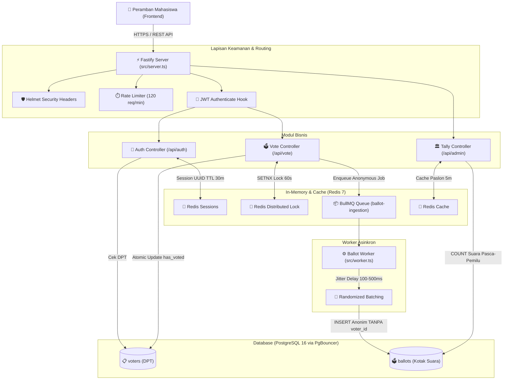
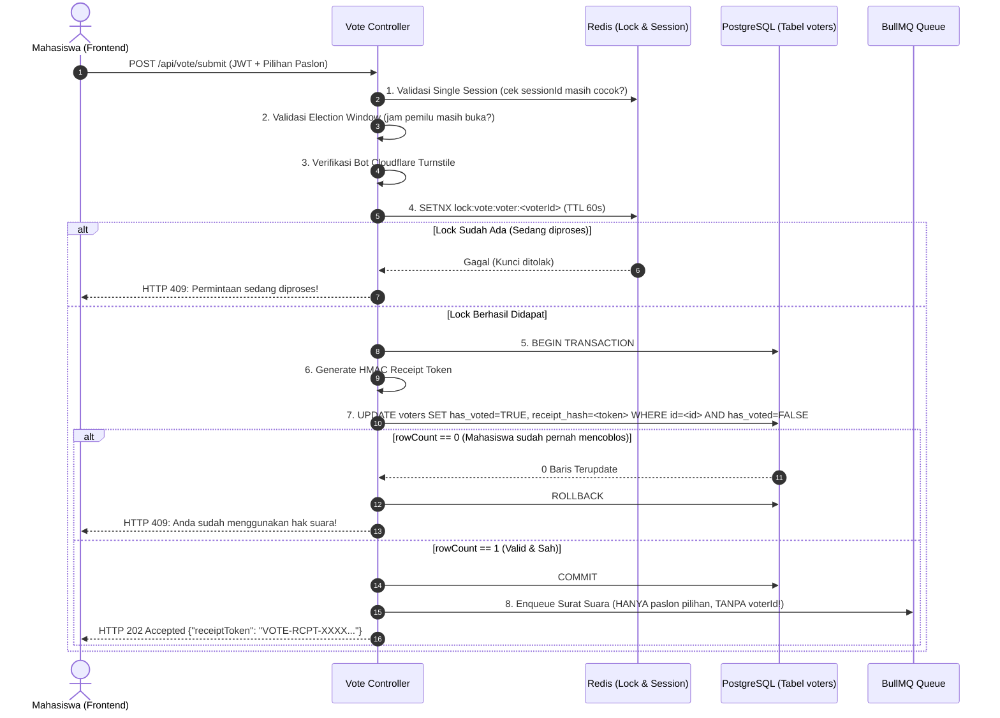

# 📘 DOKUMENTASI CARA KERJA BACKEND PEMIRA 2026
**Panduan Komprehensif Arsitektur, Alur Transaksi, Keamanan Kriptografi, dan Penanganan Konkurensi**

---

## 📑 Daftar Isi
1. [Prinsip Desain & Filosofi Sistem](#1-prinsip-desain--filosofi-sistem)
2. [Peta Arsitektur Komponen](#2-peta-arsitektur-komponen)
3. [Alur Kerja (Flow) Setiap Fitur Inti](#3-alur-kerja-flow-setiap-fitur-inti)
   - [A. Autentikasi SSO & Single Session Enforcement](#a-autentikasi-sso--single-session-enforcement)
   - [B. Pengambilan Profil Paslon Berkecepatan Tinggi (Caching)](#b-pengambilan-profil-paslon-berkecepatan-tinggi-caching)
   - [C. Submit Suara: Zero Linkability & Anti Coblos Ganda (Core Engine)](#c-submit-suara-zero-linkability--anti-coblos-ganda-core-engine)
   - [D. Pemrosesan Kotak Suara Asinkron (BullMQ Worker)](#d-pemrosesan-kotak-suara-asinkron-bullmq-worker)
   - [E. Rekapitulasi Suara Terkarantina (Dual-Control Quorum)](#e-rekapitulasi-suara-terkarantina-dual-control-quorum)
4. [Skema Basis Data & Desain Tabel](#4-skema-basis-data--desain-tabel)
5. [Strategi Ketahanan Konkurensi Ekstrem (3.000–5.000 User Serentak)](#5-strategi-ketahanan-konkurensi-ekstrem-30005000-user-serentak)
6. [Struktur Folder & Penjelasan Setiap File](#6-struktur-folder--penjelasan-setiap-file)

---

## 1. Prinsip Desain & Filosofi Sistem

Sistem backend PEMIRA 2026 dirancang untuk menegakkan prinsip pemilu **Luber Jurdil (Langsung, Umum, Bebas, Rahasia, Jujur, dan Adil)** di ranah digital:

| Aspek | Solusi Backend | Mengapa Penting? |
| :--- | :--- | :--- |
| **Kerahasiaan (Rahasia)** | **Zero-Linkability & Decoupled Ballot Box** | Siapa pun yang mengakses database (termasuk DBA/Panitia) tidak dapat melacak paslon mana yang dicoblos oleh mahasiswa tertentu. |
| **Anti-Coblos Ganda (Jujur)** | **2-Layer Protection (Redis Lock + DB Atomic Update)** | Mahasiswa tidak dapat membuka 2 tab peramban dan mengklik submit bersamaan (*race condition* langsung diblokir). |
| **Keabsahan Pemilih (Umum)** | **Whitelist Domain SSO & Real-Time DPT Match** | Hanya mahasiswa aktif dengan email kampus resmi yang terdaftar di DPT yang dapat memilih. |
| **Integritas Waktu (Adil)** | **Quarantined Tally & Election Window Guard** | Hasil suara tidak dapat diintip sebelum pemilu ditutup, mencegah manipulasi opini publik saat jam voting berlangsung. |
| **Performa Tinggi** | **Fastify + BullMQ + PgBouncer + Redis** | Mampu melayani lonjakan akses ribuan mahasiswa serentak di menit-menit awal pemilu tanpa *crash* atau *database deadlock*. |

---

## 2. Peta Arsitektur Komponen



---

## 3. Alur Kerja (Flow) Setiap Fitur Inti

### A. Autentikasi SSO & Single Session Enforcement
**File Utama:** [`src/modules/auth/auth.service.ts`](src/modules/auth/auth.service.ts), [`src/modules/auth/auth.controller.ts`](src/modules/auth/auth.controller.ts)

1. Mahasiswa login dengan akun Google Kampus di frontend. Frontend mengirimkan `idToken` ke endpoint `POST /api/auth/login-sso`.
2. **Validasi Google Token:** Backend memverifikasi tanda tangan kriptografi token ke Google Auth API (`OAuth2Client`).
3. **Validasi Domain:** Sistem memeriksa domain email. Hanya email berakhiran `@mahasiswa.ac.id`, `@campus.ac.id`, atau domain yang diizinkan yang dapat lolos.
4. **Pencocokan DPT:** Backend mengecek tabel `voters`. Jika email tidak ada di DPT, akses ditolak (`HTTP 403 NOT_IN_DPT`).
5. **Single Session Enforcement:**
   - Dihasilkan `sessionId` unik berbasis UUID.
   - Sesi disimpan ke Redis dengan key `session:voter:<voter_id>` (TTL 30 menit).
   - **Efek:** Jika akun yang sama dibuka di HP dan Laptop, login di HP akan langsung menimpa key di Redis, sehingga sesi di Laptop otomatis terputus (*invalidated*).
6. **Penerbitan JWT:** Diterbitkan JWT token dengan payload `{ voterId, nim, email, sessionId }`.

---

### B. Pengambilan Profil Paslon Berkecepatan Tinggi (Caching)
**File Utama:** [`src/modules/election/election.service.ts`](src/modules/election/election.service.ts)

- Saat ribuan mahasiswa membuka bilik suara secara bersamaan, query database untuk daftar paslon tidak dilakukan berulang kali.
- Data paslon disimpan di memory Redis (`cache:election:categories:<electionId>`) dengan TTL 5 menit.
- Backend melayani request `GET /api/vote/candidates` dalam hitungan sub-milidetik (1-3 ms), membebaskan database dari beban baca berlebih.

---

### C. Submit Suara: Zero Linkability & Anti Coblos Ganda (Core Engine)
**File Utama:** [`src/modules/vote/vote.service.ts`](src/modules/vote/vote.service.ts), [`src/modules/vote/vote.controller.ts`](src/modules/vote/vote.controller.ts)

Ini adalah alur paling krusial dalam pemilu digital. Urutan eksekusinya:



#### Mengapa Pola Ini Menjamin Kerahasiaan (Zero Linkability)?
1. **Pemisahan Data:** Status keikutsertaan dicatat di tabel `voters` (siapa yang mencoblos), sedangkan suara dicatat di tabel `ballots` (apa yang dicoblos).
2. **Ketiadaan Foreign Key:** Tabel `ballots` sama sekali tidak memiliki kolom `voter_id`, `nim`, ataupun `email`.
3. **Payload Antrean Anonim:** Data yang dilempar ke antrean BullMQ hanya berisi:
   ```json
   {
     "electionId": "uuid-pemira-2026",
     "votes": [
       { "categoryId": "uuid-presma", "candidateId": "uuid-paslon-01" }
     ],
     "enqueuedAt": 1728738900
   }
   ```
   Identitas mahasiswa tidak pernah menyentuh antrean surat suara!

---

### D. Pemrosesan Kotak Suara Asinkron (BullMQ Worker)
**File Utama:** [`src/modules/vote/vote.worker.ts`](src/modules/vote/vote.worker.ts), [`src/worker.ts`](src/worker.ts)

Jika 5.000 mahasiswa mengklik tombol submit dalam rentang 1 menit, melakukan write serentak ke tabel suara akan menyebabkan *database lock contention*. Worker asinkron mengatasinya dengan cara:

1. **Jitter Delay (Anti-Timing Attack):**
   Worker memberikan jeda acak 100ms – 500ms sebelum menulis ke database. Hal ini mengacak mikro-kronologi, sehingga peretas tidak bisa mencocokkan waktu `voted_at` di tabel DPT dengan waktu insert suara di database.
2. **Penulisan Suara Anonim:**
   Worker memasukkan surat suara ke tabel `ballots` dengan atribut tanggal agregat (`CURRENT_DATE`), bukan *microsecond timestamp*.
3. **Konkurensi Worker:**
   Worker berjalan di proses terpisah dengan concurrency 20, menguras antrean ribuan suara dengan stabil tanpa membebani server HTTP.

---

### E. Rekapitulasi Suara Terkarantina (Dual-Control Quorum)
**File Utama:** [`src/modules/admin/tally.controller.ts`](src/modules/admin/tally.controller.ts)

Hasil perolehan suara dilindungi secara ketat agar tidak ada yang bisa melihat "quick count" selama pemilihan berlangsung:

1. **Dual-Control Secret:** Request ke endpoint `POST /api/admin/tally-results` wajib menyertakan dua header rahasia:
   - `x-kpu-secret-key` (Kunci milik Komisi Pemilihan Umum)
   - `x-bawaslu-secret-key` (Kunci milik Badan Pengawas Pemira)
2. **Time Gating (Karantina Waktu):**
   Meskipun kedua kunci dimasukkan dengan benar, jika waktu sekarang masih lebih kecil dari `end_time` pemilihan, server **menolak request** (`HTTP 403 ELECTION_STILL_ACTIVE`).
3. **Perhitungan Suara Pasca-Pemilihan:**
   Setelah bilik suara resmi ditutup, sistem melakukan kalkulasi agregasi `COUNT(b.id)` dari tabel `ballots` dan mencocokkan jumlah surat suara dengan jumlah pemilih yang berstatus `has_voted = TRUE` untuk audit integritas.

---

## 4. Skema Basis Data & Desain Tabel

Database menggunakan **PostgreSQL 16**. Struktur tabel inti:

### 1. Tabel `voters` (Daftar Pemilih Tetap)
Mencatat identitas pemilih dan status apakah mereka sudah menggunakan hak suaranya:
- `id` (UUID - Primary Key)
- `nim` (VARCHAR - Unique)
- `email` (VARCHAR - Unique)
- `full_name`, `faculty`, `study_program`
- `has_voted` (BOOLEAN - Default FALSE)
- `voted_at` (TIMESTAMPTZ - Waktu coblos)
- `receipt_hash` (VARCHAR - Hash tanda terima digital HMAC)

### 2. Tabel `ballots` (Kotak Suara Digital - ZERO LINKABILITY)
Mencatat surat suara yang sah tanpa kaitan ke pemilih:
- `id` (UUID - Primary Key Acak)
- `election_id` (UUID - Relasi ke pemilihan)
- `category_id` (UUID - Kategori jabatan, misal Presma)
- `candidate_id` (UUID - Paslon yang dipilih)
- `batch_id` (UUID - Penanda batch acak)
- `created_date` (DATE - Hanya tanggal, tanpa jam/detik presisi)

> **Catatan Kritis:** Sama sekali TIDAK ADA kolom `voter_id` pada tabel `ballots`!

---

## 5. Strategi Ketahanan Konkurensi Ekstrem (3.000–5.000 User Serentak)

Untuk menjamin sistem tidak down saat terjadi lonjakan traffic:

1. **Fastify Framework:** Memiliki throughput HTTP 2x hingga 3x lebih tinggi dibanding Express.js dengan overhead memori yang sangat rendah.
2. **PgBouncer Connection Pooler:** Menggunakan mode *Transaction Pooling*. 5.000 koneksi masuk dari client dirampingkan menjadi 50 koneksi fisik ke PostgreSQL, mencegah kehabisan RAM database.
3. **Redis In-Memory Distributed Lock:** Operasi `SETNX` berjalan dalam memori Redis (< 1 ms), memotong race condition sebelum request sempat membebani database.
4. **BullMQ Message Broker:** Menampung ribuan transaksi suara di buffer Redis saat lonjakan puncak, lalu dieksekusi secara teratur oleh worker.

---

## 6. Struktur Folder & Penjelasan Setiap File

```text
d:\Pemira2026/
├── package.json             # Dependensi Fastify, BullMQ, ioredis, pg, zod
├── tsconfig.json            # Konfigurasi TypeScript compiler
├── Dockerfile               # Container build multi-stage (Node 20 Alpine)
├── README.md                # Panduan instalasi & quick-start backend
├── SYSTEM_DESIGN.md         # Blueprint arsitektur tingkat sistem
├── BACKEND_ARCHITECTURE.md  # Dokumen cara kerja backend ini
│
├── src/
│   ├── server.ts            # Entry point HTTP server Fastify & pendaftaran route
│   ├── worker.ts            # Entry point background worker BullMQ
│   │
│   ├── config/
│   │   ├── env.ts           # Validasi variabel lingkungan (.env) menggunakan Zod
│   │   ├── db.ts            # PostgreSQL connection pooler (pg.Pool)
│   │   └── redis.ts         # Inisialisasi klien Redis (ioredis)
│   │
│   ├── plugins/
│   │   └── security.ts      # Generator HMAC Receipt Token & Cloudflare Turnstile verifier
│   │
│   └── modules/
│       ├── auth/
│       │   ├── auth.service.ts     # Logika verifikasi Google SSO, DPT matching, & Single Session
│       │   └── auth.controller.ts  # Endpoint /api/auth/login-sso, /me, /logout
│       │
│       ├── election/
│       │   └── election.service.ts # Caching data paslon di Redis & validasi jam pemilu
│       │
│       ├── vote/
│       │   ├── vote.controller.ts  # Endpoint /api/vote/candidates & /api/vote/submit
│       │   ├── vote.service.ts     # Core Engine: Redis Lock, Atomic Update DPT, & Queue Enqueue
│       │   ├── vote.queue.ts       # Definisi antrean BullMQ
│       │   └── vote.worker.ts      # Ballot Consumer (Jitter delay & insert suara anonim)
│       │
│       └── admin/
│           └── tally.controller.ts # Endpoint rekapitulasi terkarantina (Dual-Control Quorum)
│
├── docker/
│   ├── docker-compose.yml   # Orkestrasi Postgres, Redis, PgBouncer, Nginx, API, & Worker
│   ├── postgres/init.sql    # Skema DDL SQL lengkap & sampel data paslon
│   ├── pgbouncer/           # Konfigurasi PgBouncer connection pooler
│   └── nginx/nginx.conf     # Konfigurasi reverse proxy Nginx & rate limiting
│
└── load-tests/              # Skrip k6 pengujian beban 8.000 pemilih
    ├── data/generate_mock_dpt.js
    └── scripts/spike-test.js
```
