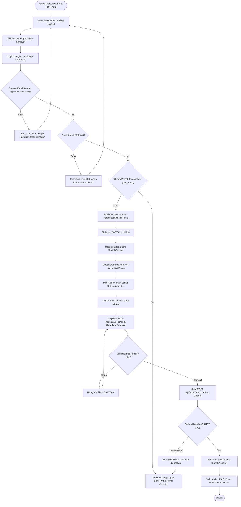
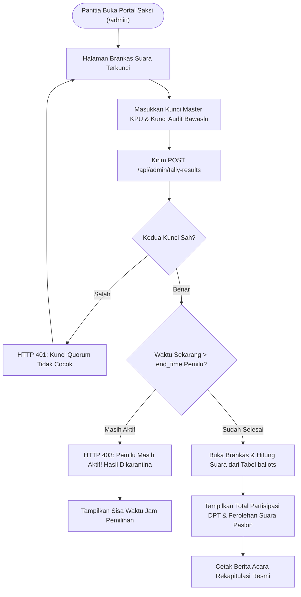

# 🎨 USER FLOW & WIREFRAME SPECIFICATION
## SISTEM E-VOTING PEMIRA 2026

Dokumen ini memetakan alur navigasi pengguna (*User Flow*) serta rancangan cetak biru antarmuka (*Wireframe*) untuk memastikan pengalaman pengguna yang intuitif, cepat, responsif, dan bebas ambiguitas saat memberikan hak suara.

---

## 1. Diagram Alur Pengguna (User Flow Diagrams)

### A. Alur Pemilih (Mahasiswa / Voter Flow)



---

### B. Alur Saksi & Panitia (Admin & Quorum Tally Flow)



---

## 2. Cetak Biru Antarmuka (Screen Wireframes)

### Wireframe 1: Halaman Login & SSO Portal (`/`)

```text
+--------------------------------------------------------------------------+
|  [Logo Kampus]  PEMIRA KAMPUS 2026             [Panel Saksi] [Status: Luber] |
+--------------------------------------------------------------------------+
|                                                                          |
|                           [ Ikon Kotak Suara ]                           |
|                      PEMILIHAN UMUM RAYA 2026                            |
|             Komisi Pemilihan Umum Mahasiswa (KPU Kampus)                 |
|                                                                          |
|     +--------------------------------------------------------------+     |
|     |                                                              |     |
|     |  Silakan masuk menggunakan akun resmi kampus Anda            |     |
|     |                                                              |     |
|     |  [ Email Kampus: pemilih1@mahasiswa.ac.id                ]   |     |
|     |                                                              |     |
|     |  [  🔴 MASUK DENGAN GOOGLE WORKSPACE SSO        -->  ]       |     |
|     |                                                              |     |
|     |  ----------------------------------------------------------  |     |
|     |  Uji Coba Cepat (Akun DPT Seed):                             |     |
|     |  [ Andi Pratama (TIK) ]           [ Bella Safitri (Manaj) ]  |     |
|     +--------------------------------------------------------------+     |
|                                                                          |
|       [✔ Zero Linkability]    [✔ Single Session]    [✔ Anti Coblos Ganda]|
|                                                                          |
|                   © 2026 Komisi Pemilihan Umum Mahasiswa                 |
+--------------------------------------------------------------------------+
```

---

### Wireframe 2: Bilik Suara Digital (`/voting`)

```text
+--------------------------------------------------------------------------+
|  PEMIRA 2026 | Bilik Suara       Halo, Andi Pratama (13523001)   [Keluar] |
+--------------------------------------------------------------------------+
|                                                                          |
|  Kategori 1 dari 2: PRESIDEN & WAKIL PRESIDEN MAHASISWA                  |
|  Silakan pilih 1 pasangan calon yang Anda percayai.                      |
|                                                                          |
|  +-------------------------------+   +-------------------------------+   |
|  | [Foto Paslon 01]              |   | [Foto Paslon 02]              |   |
|  | NO. URUT 01                   |   | NO. URUT 02                   |   |
|  | Ahmad Fauzi & Siti Rahma      |   | Bima Perkasa & Dian Lestari   |   |
|  | Teknik Informatika / Kedokteran|   | Ekonomi Bisnis / Hukum        |   |
|  |                               |   |                               |   |
|  | VISI: Kampus Inklusif & Global|   | VISI: Sinergi Keadilan Sosial |   |
|  | [ Lihat Detail Visi Misi v ]  |   | [ Lihat Detail Visi Misi v ]  |   |
|  |                               |   |                               |   |
|  | [ PILIH PASLON 01  (  ) ]     |   | [ PILIH PASLON 02  (•) ]      |   |
|  +-------------------------------+   +-------------------------------+   |
|                                                                          |
|  Kategori 2 dari 2: DEWAN PERWAKILAN MAHASISWA (DPM)                    |
|  ...                                                                     |
|                                                                          |
|  +--------------------------------------------------------------------+  |
|  | Pilihan Anda: Paslon 02 (Presma) & Calon A (DPM)                   |  |
|  |                                    [ KIRIM SUARA SEKARANG  --> ]   |  |
|  +--------------------------------------------------------------------+  |
+--------------------------------------------------------------------------+
```

---

### Wireframe 3: Modal Konfirmasi Pilihan & Cloudflare Turnstile

```text
+--------------------------------------------------------------------------+
|                     [ KONFIRMASI SURAT SUARA ]                           |
|                                                                          |
|  Periksa kembali pilihan Anda sebelum dimasukkan ke kotak suara digital: |
|                                                                          |
|  • Presiden Mahasiswa : No. 02 - Bima Perkasa & Dian Lestari             |
|  • Dewan Perwakilan   : No. 01 - Calon DPM Teknik Informatika            |
|                                                                          |
|  PERHATIAN: Pilihan tidak dapat diubah setelah Anda menekan tombol kirim!|
|                                                                          |
|  +--------------------------------------------------------------------+  |
|  |  [✓] Cloudflare Turnstile: Terverifikasi Bukan Robot               |  |
|  +--------------------------------------------------------------------+  |
|                                                                          |
|       [ Batal / Ubah Pilihan ]      [ YA, COBLOS & MASUKKAN SUARA ]      |
+--------------------------------------------------------------------------+
```

---

### Wireframe 4: Bukti Tanda Terima Digital (`/receipt`)

```text
+--------------------------------------------------------------------------+
|  KOMISI PEMILIHAN UMUM MAHASISWA                                [Keluar] |
+--------------------------------------------------------------------------+
|                                                                          |
|                    +--------------------------------+                    |
|                    |     [ ✔ SUARA MASUK ]          |                    |
|                    |   HAK SUARA ANDA TELAH SAH     |                    |
|                    +--------------------------------+                    |
|                                                                          |
|     Nama Pemilih : Andi Pratama                                          |
|     NIM Mahasiswa: 13523001                                              |
|     Program Studi: Teknik Informatika dan Komputer                       |
|     Status Suara : SUDAH DICATAT & MASUK KOTAK DIGITAL                   |
|                                                                          |
|     ----------------------------------------------------------------     |
|     TOKEN TANDA TERIMA KRIPTOGRAFIS (HMAC-SHA256):                       |
|     [ VOTE-RCPT-A79B3E8C12F49021...               ] [ Salin Kode ]       |
|     ----------------------------------------------------------------     |
|                                                                          |
|     * Token ini membuktikan keikutsertaan Anda tanpa mengungkap paslon   |
|       yang Anda pilih (Zero Linkability). Simpan bukti ini dengan baik.  |
|                                                                          |
|            [ 🖨 Cetak Bukti Tanda Terima ]     [ Selesai / Logout ]       |
+--------------------------------------------------------------------------+
```

---

### Wireframe 5: Panel Saksi & Pembukaan Brankas Quorum (`/admin`)

```text
+--------------------------------------------------------------------------+
|  [Ikon Perisai] PANEL SAKSI & REKAPITULASI RESMI          [Kembali ke Home]|
+--------------------------------------------------------------------------+
|                                                                          |
|     +--------------------------------------------------------------+     |
|     |                   [ Ikon Gembok Brankas ]                    |     |
|     |                  OTORISASI GANDA (QUORUM)                    |     |
|     |  Rekapitulasi terkunci dan membutuhkan 2 kunci otorisasi sah |     |
|     |                                                              |     |
|     |  Kunci Master KPU:                                           |     |
|     |  [ ************************************ ]                    |     |
|     |                                                              |     |
|     |  Kunci Audit Bawaslu:                                        |     |
|     |  [ ************************************ ]                    |     |
|     |                                                              |     |
|     |  [   🔓 OTORISASI & BUKA HASIL SUARA   ]                     |     |
|     +--------------------------------------------------------------+     |
|                                                                          |
|  -- TAMPILAN SETELAH BRANKAS BERHASIL DIBUKA --                          |
|                                                                          |
|  [ Total DPT: 8.000 ]    [ Suara Masuk: 5.420 ]    [ Partisipasi: 67.75%]|
|                                                                          |
|  Kategori: PRESIDEN & WAKIL PRESIDEN MAHASISWA                           |
|  +--------------------------------------------------------------------+  |
|  | No. 01 - Ahmad Fauzi & Siti Rahma           | 2.300 Suara (42.4%)  |  |
|  | No. 02 - Bima Perkasa & Dian Lestari        | 3.120 Suara (57.6%)  |  |
|  +--------------------------------------------------------------------+  |
+--------------------------------------------------------------------------+
```
