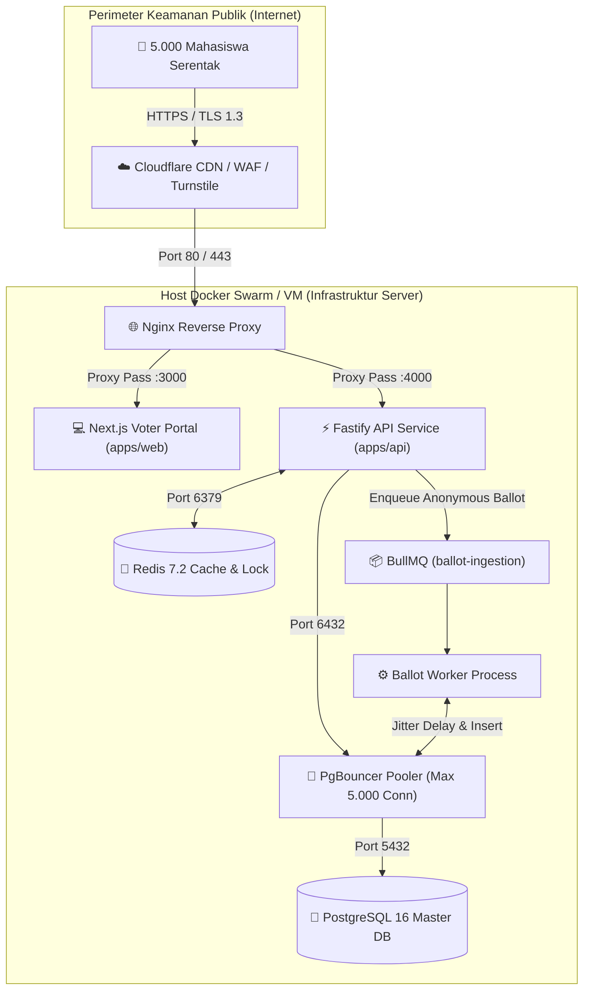

# ⚙️ TECHNICAL DESIGN DOCUMENT (TDD)
## SISTEM E-VOTING PEMIRA 2026
**Arsitektur Terdistribusi Berperforma Tinggi & Berintegritas Kriptografis**

---

## 1. Pilihan Tech Stack & Rasionalisasi Teknis

| Komponen | Teknologi Terpilih | Rasionalisasi & Keunggulan Dibanding Alternatif |
| :--- | :--- | :--- |
| **Backend Runtime & Framework** | **Node.js 20+ & Fastify (TypeScript)** | Fastify memiliki throughput mencapai $\sim 70.000\text{ req/sec}$ (2.5x lebih cepat dibanding Express.js) dengan overhead parsing JSON terendah, arsitektur plugin modular, dan skema validasi internal yang sangat efisien. |
| **Message Broker & Queue** | **BullMQ 5+ (didukung Redis)** | Menghindari kompleksitas operasional RabbitMQ/Kafka sambil menyediakan jaminan eksekusi *at-least-once*, *retry backoff*, dan buffer penahan beban saat ribuan suara masuk serentak. |
| **Basis Data Relasional** | **PostgreSQL 16 (Alpine)** | Dukungan transaksi ACID tingkat tinggi, fungsi native `gen_random_uuid()` dan `pgcrypto`, serta performa indeks B-Tree yang sangat optimal untuk pencarian DPT dan audit. |
| **Connection Pooler** | **PgBouncer 1.22 (Transaction Mode)** | Menghubungkan hingga **5.000 koneksi client** ke PostgreSQL hanya dengan **50 koneksi fisik backend**, mencegah crash memori (*OOM*) akibat konsumsi RAM per proses PostgreSQL. |
| **In-Memory Store & Cache** | **Redis 7.2 (AOF + RDB)** | Digunakan untuk 3 fungsi kritis: (1) Distributed Lock `SETNX`, (2) Session Store dengan TTL otomatis, dan (3) In-Memory Cache untuk profil paslon. |
| **Frontend Framework** | **Next.js 14 (App Router) + Tailwind CSS** | Server Component untuk rendering awal yang cepat, Client Component untuk interaktivitas bilik suara, serta *mobile-first CSS bundle* yang ringkas (< 80 KB). |
| **Reverse Proxy & Ingress** | **Nginx 1.25** | Melakukan SSL Termination, kompresi Gzip/Brotli, dan perlindungan *Layer 7 Rate Limiting* sebelum request menyentuh Fastify API. |

---

## 2. Diagram Arsitektur Infrastruktur & Aliran Data



---

## 3. Strategi Penanganan Konkurensi Ekstrem (3.000–5.000 VU)

### A. Pola *Connection Pool Funneling* (PgBouncer)
Jika 5.000 mahasiswa mengirim request serentak ke PostgreSQL tanpa pooler, PostgreSQL akan membuat 5.000 *worker process* yang mengonsumsi $\approx 5.000 \times 10\text{ MB} = 50\text{ GB RAM}$, menyebabkan server *freeze*.

**Solusi yang Diterapkan:**
```ini
; Konfigurasi docker/pgbouncer/pgbouncer.ini
pool_mode = transaction
max_client_conn = 5000
default_pool_size = 50
reserve_pool_size = 10
max_db_connections = 100
```
PgBouncer menampung 5.000 koneksi client dan mengantrekan query transaksi ke dalam 50 koneksi fisik database yang selalu hangat (*warm*). Penggunaan RAM database tetap stabil di bawah 1 GB.

---

### B. Pola *Distributed Locking* Anti-Race Condition
Untuk mencegah mahasiswa membuka 2 tab browser dan mengklik submit secara serentak:

```typescript
// Eksekusi atomik dalam memori Redis (< 0.5 ms)
const lockKey = `lock:vote:voter:${voterId}`;
const lockAcquired = await redis.set(lockKey, '1', 'EX', 60, 'NX');

if (!lockAcquired) {
  throw new Error('DUPLICATE_REQUEST: Permintaan voting sedang diproses.');
}
```
Operasi `SET ... EX 60 NX` adalah perintah atomik tunggal di CPU Redis. Jika ada dua request yang tiba dalam selisih nanodetik, hanya tepat 1 request yang mengembalikan `OK`, sedangkan request lainnya langsung ditolak sebelum menyentuh database.

---

### C. Pemrosesan Asinkron Kotak Suara (BullMQ)
Menulis surat suara langsung ke tabel saat ribuan user submit serentak akan menimbulkan *table lock contention*. 
Backend membagi transaksi menjadi 2 fase:
1. **Fase Sinkron (< 15 ms):** Kunci status pemilih di tabel DPT (`has_voted = TRUE`) dan enqueue payload pilihan ke BullMQ. Kembalikan `HTTP 202 Accepted` ke pemilih.
2. **Fase Asinkron (Worker Pool):** Worker mengambil job dari antrean, menyisipkan *randomized jitter delay* (100–500 ms), lalu melakukan batch insert ke tabel `ballots`.

---

## 4. Landasan Kriptografi Zero-Linkability & Anti-Timing Attack

### A. Formula Bukti Tanda Terima (Cryptographic Voting Receipt)
Tanda terima digital membuktikan mahasiswa telah menggunakan hak suara secara sah tanpa mengungkap paslon yang dipilih:

$$\text{ReceiptToken} = \text{"VOTE-RCPT-"} \parallel \text{HMAC-SHA256}(VoterID \parallel ElectionID, K_{server})$$

- Token ini disimpan sebagai `receipt_hash` pada tabel `voters`.
- Token yang sama diserahkan kepada pemilih di browser.
- **Karakteristik:** Bersifat satu arah (*one-way*). Mengetahui token tanda terima tidak memungkinkan siapa pun untuk merekonstruksi pilihan calon mahasiswa.

---

### B. Mitigasi Serangan Korelasi Waktu (Anti-Timing Correlation Attack)

#### Ancaman:
Meskipun tabel `voters` dan `ballots` dipisah, penyerang yang memiliki akses ke database dapat mencocokkan waktu `voted_at` di tabel DPT dengan waktu `created_at` di tabel kotak suara jika keduanya memiliki timestamp milidetik presisi tinggi:
$$\text{If } |t_{voter\_at} - t_{ballot\_created}| < 100\text{ ms} \implies \text{Pilihan Terbongkar!}$$

#### Solusi yang Diterapkan di Worker:
1. **Penyisipan Jitter Acak:** Worker sengaja menunda eksekusi penulisan dengan rentang acak:
   $$\Delta t_{jitter} = \text{Random}(100\text{ ms}, 500\text{ ms})$$
2. **Batch ID Acak:** Setiap mikro-batch suara diberi `batch_id` (UUIDv4) independen.
3. **Trunkasi Timestamp:** Kolom waktu di tabel `ballots` hanya mencatat `created_date DATE` (hari/tanggal), **tanpa kolom jam, menit, detik, ataupun milidetik**.

Dengan ketiga mitigasi ini, korelasi waktu antara pemilih dan surat suara terputus total secara matematis dan kronologis.

---

## 5. Arsitektur Keamanan Siber (Security Topology)

```mermaid
graph LR
    User["Peramban Mahasiswa"] -->|Layer 7 DDoS & Bot Filter| CF["Cloudflare Turnstile & WAF"]
    CF -->|SSL Termination & Rate Limit (120 req/m)| Nginx["Nginx Reverse Proxy"]
    Nginx -->|Security Headers (CSP, HSTS)| Fastify["Fastify Helmet"]
    Fastify -->|Validasi Schema Zod| InputValidation["Strict DTO Validation"]
    InputValidation -->|JWT HS256 + Session Check| AuthFilter["Auth Guard"]
    AuthFilter -->|Dual-Control Secret (x-kpu & x-bawaslu)| TallyGuard["Quarantine Tally Guard"]
```

1. **Dual-Control Quorum Secret:** Endpoint rekapitulasi mewajibkan dua header HTTP:
   - `x-kpu-secret-key`: Dipegang oleh Ketua KPU Mahasiswa.
   - `x-bawaslu-secret-key`: Dipegang oleh Ketua Panitia Pengawas (Bawaslu).
   - Keduanya harus cocok dan waktu pemilihan harus telah usai (`NOW() > end_time`), barulah database mengizinkan query rekapitulasi.
