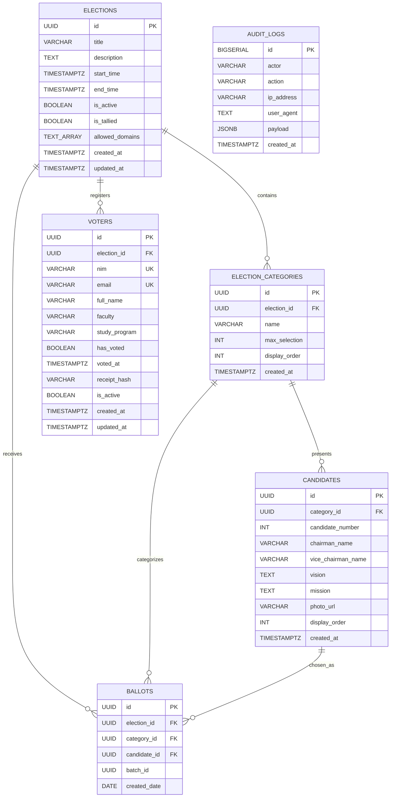

# 🗄️ ENTITY RELATIONSHIP DIAGRAM (ERD) & SKEMA DATABASE
## SISTEM E-VOTING PEMIRA 2026
**Engine: PostgreSQL 16+ | Desain: Decoupled Zero-Linkability Pattern**

---

## 1. Diagram Relasi Entitas (Entity Relationship Diagram)

Di bawah ini adalah diagram arsitektur database. Perhatikan garis putus-putus merah yang menunjukkan **isolasi total** antara tabel `voters` dan tabel `ballots`:



> ⚠️ **Prinsip Utama Zero-Linkability:**  
> Tabel `BALLOTS` sama sekali **TIDAK MEMILIKI** kolom `voter_id` atau relasi Foreign Key apa pun ke tabel `VOTERS`.

---

## 2. Kamus Data & Definisi Kolom (Data Dictionary)

### 1. Tabel `elections` (Konfigurasi Sesi Pemilu)
| Nama Kolom | Tipe Data | Keterangan & Batasan |
| :--- | :--- | :--- |
| `id` | `UUID` | **Primary Key** (`gen_random_uuid()`). |
| `title` | `VARCHAR(150)` | Judul resmi agenda pemilihan (misal: PEMIRA 2026/2027). |
| `description` | `TEXT` | Deskripsi umum dan tata tertib pemilihan. |
| `start_time` | `TIMESTAMPTZ` | Waktu bilik suara dibuka resmi oleh KPU. |
| `end_time` | `TIMESTAMPTZ` | Batas akhir jam pemungutan suara resmi ditutup. |
| `is_active` | `BOOLEAN` | Status tombol darurat panitia (Default: `FALSE`). |
| `is_tallied` | `BOOLEAN` | Penanda apakah brankas suara telah dibuka resmi pasca-pemilu. |
| `allowed_domains` | `TEXT[]` | Whitelist domain email resmi (contoh: `['mahasiswa.ac.id', 'stu.pnj.ac.id']`). |

---

### 2. Tabel `election_categories` (Kategori Jabatan / Kursi)
| Nama Kolom | Tipe Data | Keterangan & Batasan |
| :--- | :--- | :--- |
| `id` | `UUID` | **Primary Key**. |
| `election_id` | `UUID` | **Foreign Key** ke `elections.id` (ON DELETE CASCADE). |
| `name` | `VARCHAR(100)` | Nama jabatan (Presiden Mahasiswa, MPM, HMJ TIK). |
| `max_selection` | `INT` | Jumlah calon yang boleh dicoblos (Default: `1`). |
| `display_order` | `INT` | Urutan tampilan kartu pada bilik suara digital. |

---

### 3. Tabel `candidates` (Pasangan Calon / Paslon)
| Nama Kolom | Tipe Data | Keterangan & Batasan |
| :--- | :--- | :--- |
| `id` | `UUID` | **Primary Key**. |
| `category_id` | `UUID` | **Foreign Key** ke `election_categories.id`. |
| `candidate_number` | `INT` | Nomor urut resmi paslon (1, 2, 3) - **Unique per category**. |
| `chairman_name` | `VARCHAR(150)` | Nama lengkap calon ketua/presiden mahasiswa. |
| `vice_chairman_name`| `VARCHAR(150)` | Nama lengkap calon wakil (opsional). |
| `vision` | `TEXT` | Narasi visi paslon. |
| `mission` | `TEXT` | Poin-poin misi paslon. |
| `photo_url` | `VARCHAR(255)` | URL gambar profil resmi paslon (Cloudflare R2 / S3 / CDN). |

---

### 4. Tabel `voters` (Daftar Pemilih Tetap - DPT)
| Nama Kolom | Tipe Data | Keterangan & Batasan |
| :--- | :--- | :--- |
| `id` | `UUID` | **Primary Key**. |
| `election_id` | `UUID` | **Foreign Key** ke `elections.id`. |
| `nim` | `VARCHAR(20)` | Nomor Induk Mahasiswa (**Unique per election**). |
| `email` | `VARCHAR(150)` | Email kampus resmi (**Unique per election**). |
| `full_name` | `VARCHAR(150)` | Nama lengkap mahasiswa terdaftar. |
| `faculty` | `VARCHAR(100)` | Fakultas asal pemilih. |
| `study_program` | `VARCHAR(100)` | Program studi / Jurusan asal pemilih. |
| `has_voted` | `BOOLEAN` | Penanda status penggunaan hak suara (Default: `FALSE`). |
| `voted_at` | `TIMESTAMPTZ` | Waktu mahasiswa menyelesaikan pencoblosan. |
| `receipt_hash` | `VARCHAR(128)` | Token bukti tanda terima digital (**HMAC-SHA256**). |
| `is_active` | `BOOLEAN` | Status hak pilih mahasiswa (Default: `TRUE`). |

---

### 5. Tabel `ballots` (Kotak Suara Digital Terisolasi - ZERO LINKABILITY)
| Nama Kolom | Tipe Data | Keterangan & Batasan |
| :--- | :--- | :--- |
| `id` | `UUID` | **Primary Key** acak (`gen_random_uuid()`). |
| `election_id` | `UUID` | **Foreign Key** ke `elections.id`. |
| `category_id` | `UUID` | **Foreign Key** ke `election_categories.id`. |
| `candidate_id` | `UUID` | **Foreign Key** ke `candidates.id` (Paslon yang dipilih). |
| `batch_id` | `UUID` | ID acak yang disematkan worker saat batch ingestion. |
| `created_date` | `DATE` | Hanya mencatat tanggal pemilu (`CURRENT_DATE`), **tanpa waktu jam/detik**. |

---

### 6. Tabel `audit_logs` (Rekam Jejak Keamanan Sistem)
| Nama Kolom | Tipe Data | Keterangan & Batasan |
| :--- | :--- | :--- |
| `id` | `BIGSERIAL` | **Primary Key**. |
| `actor` | `VARCHAR(150)` | Subjek pelaku aksi (Email pemilih atau Panitia KPU). |
| `action` | `VARCHAR(100)` | Jenis aktivitas: `LOGIN_SSO`, `VOTE_ACCEPTED`, `TALLY_OPENED`. |
| `ip_address` | `VARCHAR(45)` | Alamat IP pemanggil (IPv4 / IPv6). |
| `user_agent` | `TEXT` | Informasi browser & OS pemanggil. |
| `payload` | `JSONB` | Data audit non-sensitif tambahan. |

---

## 3. Strategi Pengindeksan & Optimasi Query (Indexing Strategy)

Untuk melayani jutaan pencarian data saat 5.000 mahasiswa login serentak:

```sql
-- 1. Index pencarian instan saat verifikasi SSO DPT
CREATE INDEX IF NOT EXISTS idx_voters_email_search ON voters(email);

-- 2. Index komposit pencocokan pemilihan dan status coblos
CREATE INDEX IF NOT EXISTS idx_voters_election_voted ON voters(election_id, has_voted);

-- 3. Index komposit agregasi rekapitulasi suara pasca-pemilu
CREATE INDEX IF NOT EXISTS idx_ballots_tally ON ballots(election_id, category_id, candidate_id);

-- 4. Index audit log berbasis waktu
CREATE INDEX IF NOT EXISTS idx_audit_logs_action_date ON audit_logs(action, created_at DESC);
```
Semua indeks menggunakan struktur **B-Tree** yang menjamin waktu pencarian $O(\log N)$ (kurang dari $1\text{ ms}$ untuk 8.000 hingga 100.000 baris data).
