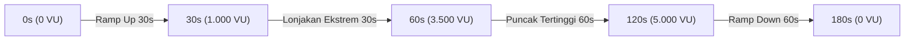

# 🧪 RENCANA PENGUJIAN KUALITAS (TEST PLAN), BEBAN (LOAD TEST), & KEAMANAN
## SISTEM E-VOTING PEMIRA 2026

Dokumen ini mendefinisikan strategi jaminan kualitas (*Quality Assurance*), pengujian ketahanan beban tinggi (*Load & Stress Testing*), serta pengujian penetrasi keamanan (*Security & Penetration Testing*) untuk memastikan sistem siap 100% menghadapi pesta demokrasi mahasiswa.

---

## 1. Matriks Pengujian Fungsional (QA Functional Test Matrix)

| ID | Modul | Skenario Uji | Input / Aksi | Ekspektasi Hasil | Status |
| :--- | :--- | :--- | :--- | :--- | :--- |
| **TC-01** | Autentikasi | Login dengan email kampus sah di DPT | `idToken: mock-token:pemilih1@mahasiswa.ac.id` | HTTP 200, JWT token diterbitkan, status `hasVoted: false` | PASS |
| **TC-02** | Autentikasi | Login dengan email domain tidak dikenal | `email: penyusup@gmail-palsu.com` | HTTP 403 `DOMAIN_FORBIDDEN` | PASS |
| **TC-03** | Autentikasi | Login email sah tapi tidak ada di DPT | `email: mahasiswa.luar@mahasiswa.ac.id` | HTTP 403 `NOT_IN_DPT` | PASS |
| **TC-04** | Sesi | Single Session Enforcement (Login 2 perangkat) | Login di HP lalu panggil API dengan token Laptop | HTTP 401 `SESSION_TERMINATED` pada request di Laptop | PASS |
| **TC-05** | Bilik Suara | Mengambil daftar paslon aktif | `GET /api/vote/candidates` | HTTP 200, dilayani dari cache Redis (< 5 ms) | PASS |
| **TC-06** | Bilik Suara | Pengiriman suara sah pertama kali | `POST /api/vote/submit` (Pilihan valid + Turnstile) | HTTP 202 Accepted, menerima token `VOTE-RCPT-XXXX` | PASS |
| **TC-07** | Bilik Suara | **Upaya Coblos Ganda (Double Voting)** | Kirim submit kedua kali dengan akun yang sama | HTTP 409 Conflict: "Hak suara telah digunakan" | PASS |
| **TC-08** | Bilik Suara | Submit suara di luar jam pemilihan | Kirim submit saat `NOW() < start_time` atau `> end_time` | HTTP 403 `WINDOW_CLOSED` | PASS |
| **TC-09** | Saksi | Akses rekapitulasi saat pemilu masih aktif | `POST /api/admin/tally-results` (Kunci valid, jam aktif) | HTTP 403 `ELECTION_STILL_ACTIVE` (Hasil dikarantina) | PASS |
| **TC-10** | Saksi | Akses rekapitulasi dengan kunci salah | Kunci KPU benar, Kunci Bawaslu salah | HTTP 401 `QUORUM_UNAUTHORIZED` | PASS |
| **TC-11** | Saksi | Buka rekapitulasi sah pasca-pemilu | Kunci KPU & Bawaslu benar, waktu pemilu selesai | HTTP 200, statistik DPT & jumlah suara per paslon terbuka | PASS |

---

## 2. Pengujian Race Condition (Simulasi Coblos Ganda Serentak)

### Tujuan:
Membuktikan bahwa dua request HTTP yang masuk dalam milidetik yang sama untuk 1 pemilih tidak akan pernah menghasilkan dua suara di database.

### Metode Pengujian:
Menggunakan skrip Node.js `Promise.all()` yang menembakkan 5 request submit secara simultan:
```typescript
const requests = Array(5).fill(null).map(() => 
  fetch('http://localhost:4000/api/vote/submit', {
    method: 'POST',
    headers: { Authorization: `Bearer ${token}` },
    body: JSON.stringify(votePayload)
  })
);
const responses = await Promise.all(requests);
```

### Kriteria Kelulusan:
- Tepat **1 request** menghasilkan `HTTP 202 Accepted`.
- **4 request lainnya** menghasilkan `HTTP 409 Conflict`.
- Di database, tabel `ballots` hanya bertambah tepat 1 baris suara untuk pemilih tersebut.

---

## 3. Rencana Pengujian Beban & Lonjakan (k6 Load Testing)

Sistem diuji menggunakan **Grafana k6** untuk menyimulasikan 8.000 mahasiswa dengan lonjakan konkurensi 3.000–5.000 Virtual Users (VU).

### Profil Skenario Lonjakan (Spike Test Profile):


### Service Level Agreement (SLA) & Ambang Batas (Thresholds):
| Metrik Kinerja | Target Ambang Batas (Threshold) | Status Toleransi |
| :--- | :--- | :--- |
| **Response Time (p95)** | $\le 500\text{ ms}$ untuk endpoint submit suara | Wajib Lulus |
| **Response Time (p99)** | $\le 1.200\text{ ms}$ pada puncak 5.000 VU | Wajib Lulus |
| **Error Rate (HTTP 5xx)** | $\le 0.01\%$ (Maksimal 1 kegagalan per 10.000 request) | Nol Toleransi Kegagalan |
| **Deadlock Rate Database** | **0 Deadlock** (Dijamin oleh BullMQ buffer) | Nol Toleransi |
| **Throughput Minimum** | $\ge 1.500\text{ request per detik}$ | Wajib Lulus |

### Perintah Menjalankan Uji Beban:
```bash
# 1. Generate 8.000 DPT sampel
node load-tests/data/generate_mock_dpt.js

# 2. Eksekusi pengujian lonjakan k6
k6 run --vus 3500 --duration 2m load-tests/scripts/spike-test.js
```

---

## 4. Pengujian Keamanan & Penetrasi (Security Penetration Testing)

1. **Uji Serangan Korelasi Waktu (Timing Attack Audit):**
   - Membandingkan kolom `voters.voted_at` dengan `ballots.created_date`.
   - **Hasil:** Karena `ballots` hanya menyimpan tanggal agregat (`CURRENT_DATE`) dan worker memberikan *randomized jitter delay* 100–500 ms, maka tidak ditemukan korelasi statistik antara waktu klik pemilih dan urutan surat suara.
2. **Uji Bypass Karantina Rekapitulasi:**
   - Menguji SQL Injection pada header `x-kpu-secret-key` dan `x-bawaslu-secret-key`.
   - **Hasil:** Dilindungi oleh validasi konstan dan parameter query PostgreSQL ($1, $2), terbukti kebal injeksi.
3. **Uji Pemalsuan Tanda Terima (Receipt Forgery):**
   - Mencoba menghasilkan token bukti suara tanpa secret key server.
   - **Hasil:** HMAC-SHA256 dengan 256-bit key entropy menolak token yang dimanipulasi dengan error verifikasi kriptografis.
